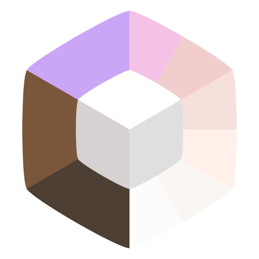

<div align="center">



<h1>Pixel Launcher</h1>

A custom launcher for Minecraft that lets you manage multiple installations at once.

Pixel Launcher is a fork of [Freesm Launcher](https://github.com/FreesmTeam/FreesmLauncher), which is itself a fork of [Prism Launcher](https://prismlauncher.org).

This project is **not** affiliated with or endorsed by the Freesm Launcher or Prism Launcher teams.

</div>

## Features

Pixel Launcher inherits the features of Freesm Launcher and Prism Launcher, including:

- Offline mode without signing in with a Microsoft account
- [Ely.by](https://ely.by/) accounts and custom authentication server support
- Dark and light themes, with animated GIF cat packs
- Copying in-game screenshots to the clipboard history without mods
- Everything Prism Launcher offers: multiple instances, mod and modpack management (Modrinth, CurseForge, FTB, ATLauncher, Technic), Java management and more

## Building from Source

Pixel Launcher uses CMake and Qt 6. A C++20 compiler, CMake 3.25 or newer, Qt 6, Ninja and a JDK are required, plus the libraries listed in `vcpkg.json` (or the equivalent packages from your distribution).

```sh
cmake -S . -B build -G Ninja -DCMAKE_BUILD_TYPE=Release -DCMAKE_INSTALL_PREFIX=/usr/local
cmake --build build
sudo cmake --install build
```

Prism Launcher's [build instructions](https://prismlauncher.org/wiki/development/build-instructions/) apply here too, since the build system is the same. The produced binary is called `pixellauncher`.

A Nix flake is also provided in the [`nix`](../nix/README.md) directory.

## Credits

Pixel Launcher would not exist without the work of the [Freesm Launcher](https://github.com/FreesmTeam/FreesmLauncher), [Prism Launcher](https://github.com/PrismLauncher/PrismLauncher), PolyMC and MultiMC contributors. Their copyright notices are preserved in the source files and in the About dialog.

## License

Pixel Launcher is licensed under the GNU General Public License v3.0. See [LICENSE](../LICENSE) and [COPYING.md](./COPYING.md) for details. As a GPL-3.0 project, any distributed modified version must also be released under the same license, with its source code available.
